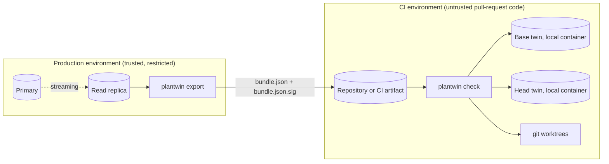
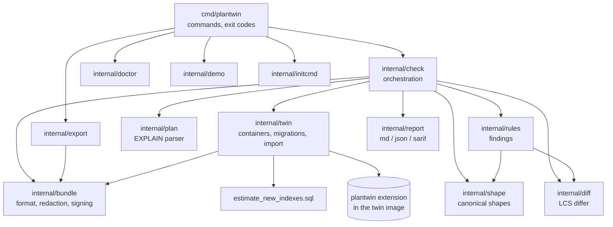

# Architecture

This document describes how PlanTwin is designed: the problem it solves, the components and their boundaries, the data
that moves between them, and how it behaves when something goes wrong. For commands and configuration see
[USAGE.md](USAGE.md). For the reasons behind individual decisions, see the records in [decisions/](decisions/).

## 1. Problem and approach

A PostgreSQL planner chooses a plan from estimates. The estimates come from statistics collected by `ANALYZE` and from
the physical size of each table. A CI database is empty, so both inputs are wrong there, and the planner chooses a
different plan than production would. A change that is harmless on an empty database can change production's plan.

PlanTwin answers the question "how does this change alter the plans production would choose?" without production rows.

- It takes the **statistics** from production (sizes, column distributions, most common values), not the data.
- It loads those statistics into an empty PostgreSQL 18 database, a *twin*, and makes the planner use the production sizes.
- It runs the same migration set at two revisions (base and head), explains a fixed query catalog on both twins, and
  compares the resulting plans by shape.

Two properties shape almost every decision below:

1. **No production rows cross the boundary.** Only redacted, signed statistics leave the replica.
2. **The planner must behave as it would in production.** This is measured, not assumed (see §10).

## 2. Context and trust boundaries

| Boundary | What crosses it | Control |
|---|---|---|
| Replica → export | SELECT on catalogs and `pg_statistic` | Read-only role, no table `SELECT` (see [privacy](privacy-and-redaction.md)) |
| Export → bundle | Redacted statistics, planner settings, server version | Redaction per column; per-export salt, never stored |
| Bundle → repository or CI | A signed JSON document | ed25519 signature; verification fails closed |
| CI → twins | Schema (from migrations) and bundle statistics | Twins are local, bound to `127.0.0.1`, and disposable |
| Pull-request code → CI | Migrations and, if configured, a migration command | Documented trust model: run `check` only on trusted refs when secrets are present |

Production never receives anything from CI. The export is a one-way, read-only step that a human or a scheduled job runs.

## 3. Components

| Component | Responsibility | Key files |
|---|---|---|
| **Extension** (C, PGXS) | Replaces the planner's size estimates for tables and indexes with imported values; estimates the B-tree height; refuses to load outside CI. | `ext/plantwin/plantwin.c` |
| **Bundle** (Go) | Defines the statistics format, applies redaction, signs and verifies. | `internal/bundle/` |
| **Export** (Go, pgx) | Reads planner settings, relation sizes and `pg_statistic` from a replica. | `internal/export/export.go` |
| **Twin** (Go) | Starts and stops PostgreSQL 18 containers through the `docker` CLI; applies migrations; imports statistics; runs the estimator; caches schemas. | `internal/twin/` |
| **Plan** (Go) | Parses `EXPLAIN (FORMAT JSON)` in three accepted forms. | `internal/plan/` |
| **Shape and diff** (Go) | Reduces a plan to what it does; finds the smallest set of changes between two shapes. | `internal/shape/`, `internal/diff/` |
| **Rules** (Go) | Converts changes into findings with severity, rationale and fix. | `internal/rules/` |
| **Report** (Go) | Renders Markdown with side-by-side plans, JSON with `schema_version`, and SARIF 2.1.0. | `internal/report/` |
| **Check** (Go) | Orchestrates one comparison end to end. | `internal/check/check.go` |
| **Doctor, init, demo** (Go) | Readiness checks, migration-tool detection, and a self-contained example. | `internal/doctor/`, `internal/initcmd/`, `internal/demo/` |
| **CLI** (Go) | Commands, flags, plain-language errors, exit codes. | `cmd/plantwin/` |

Dependencies are deliberately few: `pgx/v5` for the PostgreSQL protocol and `yaml.v3` for configuration. Everything else
is the standard library. Docker is driven through its command-line interface (ADR-0009).

## 4. The statistics bundle

The bundle is the only artifact that leaves production. It is one JSON document with `schema_version: 1`.

| Field | Content | Notes |
|---|---|---|
| `schema_version` | integer | A reader rejects any other version. |
| `exported_at` | RFC 3339 timestamp (UTC) | Used by `doctor` for the age check (14 days). |
| `server` | `version_num`, `version` | The twin must be PostgreSQL 18. |
| `settings` | name → value | Allow-list only: `work_mem`, `random_page_cost`, `enable_*`, `geqo*`, and similar. No other settings are read. |
| `redaction` | default mode and per-column overrides | Documents what was applied, so a reviewer can see it. |
| `relations` | schema, name, kind (`r` table, `m` matview, `i` index), `relpages`, `reltuples`, `relallvisible`, `relallfrozen` | From `pg_class`. |
| `attributes` | per column: type, null fraction, average width, distinct count, most common values and frequencies, histogram bounds, correlation | From `pg_statistic`, decoded as `pg_stats` does. Redacted before writing. |
| `extended_statistics` | names only | Reported, not restored (ADR-0004). |
| `warnings` | text | For example: a table with pages but no tuple estimate. |

Signing: the signature is an ed25519 signature over the exact bytes of the JSON file, stored beside it as
`<bundle>.sig` (base64). Verification uses the public key named in the configuration. A missing or non-matching
signature stops `check` before any container is started.

## 5. The extension

The extension is the only component that runs inside PostgreSQL's planner. It is small on purpose.

**What it hooks.** `get_relation_info_hook` (declared in `src/backend/optimizer/util/plancat.c`) is called after the
planner has collected a relation's information from the catalogs. The hook runs after the built-in size estimate,
so it can overwrite the result.

**What it overrides, when imported statistics exist** (`relpages > 0` and `reltuples >= 0`):

- For a table: `rel->pages`, `rel->tuples`, and `rel->allvisfrac` (from `relallvisible / relpages`, capped at 1).
- For each index: `pages`, and `tuples` using the planner's own rule (a non-partial index takes the table's tuple
  estimate; a partial index takes its own estimate, capped at the table's).
- For a B-tree: `tree_height`, estimated (see below).

**Why the B-tree height is estimated.** The planner reads the height from the index's metapage. An empty index has none,
so the height is 0, and `btcostestimate` (`src/backend/utils/adt/selfuncs.c`, line 7805) charges
`(tree_height + 1) × 50 × cpu_operator_cost` for the descent. A height of 0 makes index scans look cheaper than they are.
PostgreSQL does not store the height in `pg_class`, so the extension estimates it from the page count and the key widths
in `pg_statistic`, using the 70% fill that PostgreSQL uses for internal pages (`BTREE_NONLEAF_FILLFACTOR`). The estimate
is ADR-0002. It is correct for 42 of 44 JOB indexes and 8 of 8 TPC-H indexes.

**Guard.** Loading is refused unless `plantwin.ci_marker` is non-empty. `_PG_init` checks the marker with
`GetConfigOption` *before* it defines any setting. An earlier version defined the setting first, and a failed load then
made the next load in the same session fail with "attempt to redefine parameter". `plantwin.enabled` defaults to off
and can only be changed by a superuser. Because the guard runs in `_PG_init`, a `shared_preload_libraries` entry stops
the server from starting, which was verified (ADR-0001).

**Chaining and memory discipline.** The extension saves the previous hook and calls it first, so other extensions keep
their behaviour. Catalog tuples come from `SearchSysCache` and are released before the function returns; values are
copied out first. The extension writes nothing to disk and changes no catalog. Its changes exist only in the current
query's planner structures.

**Scope.** Per-session `LOAD` only; never preloaded in the image (ADR-0003). Partition behaviour is not yet covered by a
test.

## 6. The twin lifecycle

For each side of a check (base and head), the twin goes through these stages. The two sides run in parallel.

1. **Start.** `docker run` a PostgreSQL 18 container from the configured image, publishing port 5432 on `127.0.0.1` at a
   random host port, with `autovacuum=off`. The container waits until a connection succeeds (up to 90 seconds).
2. **Migrate.** Apply the migrations from the revision's worktree: plain SQL files in name order, a host command with
   `DATABASE_URL` set, or nothing. A failing file is reported by name.
3. **Cache.** When the tool is `sql`, the schema is cached as `.plantwin/cache/<hash>.sql`, where the hash covers the
   image name and every migration file. A later run with the same hash replays the cached schema instead of running the
   migrations (ADR-0012). Only schema is cached; statistics are always imported fresh.
4. **Import.** Relation statistics go through `pg_restore_relation_stats`, and attribute statistics through
   `pg_restore_attribute_stats`. Each call sends only the keys that have values. A failure is recorded and not fatal,
   because objects the migration changed are expected to fail.
5. **Estimate.** `estimate_new_indexes.sql` sizes every B-tree index that has no imported pages (ADR-0010). It runs on
   the twin only, as superuser, and reports the indexes it sized.
6. **Label.** Each table's signature (column names, types, nullability, index definitions) is computed on both twins.
   Tables whose signature differs, or that exist only on the head, are labelled *estimated* in the report.

The twin is never analysed or vacuumed. `ANALYZE` would overwrite the imported statistics with empty-table values; the
container's `autovacuum=off` and the absence of any `ANALYZE` call prevent that.

## 7. Explaining the query catalog

Each query is explained on each twin by a pool of workers (default four, configurable with `--parallel`). Every worker
connection is prepared in the same way:

1. `set_config('plantwin.ci_marker', 'ci:<run-id>')`. Each run has its own marker.
2. `LOAD 'plantwin'`. If this fails, the error explains that the image lacks the extension.
3. `set_config('plantwin.enabled', 'on')`.
4. Each planner setting from the bundle, via `set_config` with bound parameters (never string interpolation).

Then the query is explained with `EXPLAIN (FORMAT JSON)`, adding `GENERIC_PLAN` when the query contains a parameter
marker `$n`. A query that fails to plan produces an error for that side rather than stopping the run.

## 8. From plans to findings

1. **Parse.** `internal/plan` accepts the full EXPLAIN array, a `{"Plan": …}` object, or a bare node.
2. **Canonicalise.** `internal/shape` produces a shape tree: operator labels with their qualifiers (join type, aggregate
   strategy, CTE name), relation and index names, and child order. Estimates are dropped. A `Hash` node is transparent,
   so a hash join's inner side is its child. Each subtree has a signature (SHA-256, truncated to 64 bits), so equal
   subtrees are recognised in constant time (ADR-0007).
3. **Diff.** `internal/diff` aligns children with a longest common subsequence over signatures. A single inserted child
   is one addition, and later siblings are not reported as changed. A node whose operator, relation or index differs is
   reported once, as *replaced*, with its whole subtree.
4. **Rules.** `internal/rules` runs every applicable rule for every change, and the `shape_changed` fallback only when
   none applied. Rules search whole replaced subtrees, because a parallel plan puts its scan under `Gather`. Rules use
   the table sizes from the bundle to decide whether an index was selective (returned at least 10% of its table) and
   whether a sequential scan is the right plan (ADR-0008). Thresholds are configurable (see [rules.md](rules.md)).
5. **Accept.** Findings matching an entry in `.plantwin/accepted.json` are removed and counted in the report.

Severity decides pass or fail. Cost is always informational: a large cost ratio is reported as `info` and never fails a
check on its own.

## 9. Output and exit codes

| Format | Consumer | Notes |
|---|---|---|
| Markdown | Pull-request comment, job summary | Result, labelled findings, rationale and fix, side-by-side plans in a collapsible block, and phase timings. |
| JSON | Tools and scripts | Carries `schema_version`, `failed`, estimated relations, warnings, timings, and per-query findings. Plans are not included; `last-run.json` holds them. |
| SARIF 2.1.0 | Code-scanning | One rule per finding type; levels `error`, `warning`, `note`. |

Exit codes: `0` passed, `1` findings met `fail_on`, `2` usage or configuration error, `3` Docker or Git unavailable. The
last run is saved to `.plantwin/last-run.json` (with both plan trees) for `plantwin explain`.

## 10. Measured behaviour

The design is judged by measurements, each reproducible from `bench/`.

| Question | Method | Result | Where |
|---|---|---|---|
| Is the gap real, and does the extension close it? | Empty clone with imported statistics, with and without the extension, on TPC-H SF1 | Without: 0 of 22 shapes match. With: 22 of 22 shapes; 21 of 22 full trees including estimates. | [bench/results/fidelity.md](../bench/results/fidelity.md) |
| Does it hold on a harder schema? | JOB (113 queries, 2013 IMDb snapshot) | 112 and 113 of 113 shapes. One near-tie (0.041%) is unexplained. | same |
| How much does sampling noise matter? | Two independent `ANALYZE` runs | 31 of 113 production plans change; the twin changes in the same 31 | same |
| Does it catch regressions? | 18-case migration corpus, ground truth from `EXPLAIN ANALYZE` on migrated copies | At a 2× bar: recall 5/5, false positives 0/13. Not held out. | [bench/results/corpus/summary.md](../bench/results/corpus/summary.md) |
| What does redaction cost? | Demo dataset, three runs per mode | `hash` and `drop-mcv` change the plan for a common literal; the verdict on this dataset did not change | [bench/results/redaction/fidelity.md](../bench/results/redaction/fidelity.md) |

The corpus found two defects in the design that were then fixed: a parallel plan hid a sequential scan from the rules,
and the rules ignored index selectivity. Both are recorded in ADR-0008 and in the commit history.

## 11. Failure model

| Failure | Detected by | Behaviour |
|---|---|---|
| Docker missing or stopped | `RequireDocker` before any work | Exit 3, with the command to start Docker |
| Bundle missing, unsigned, or altered | Verification before any container starts | Exit 2; `doctor` explains the fix |
| Bundle old | `doctor` (14-day limit) | Warning; `check` still runs |
| Statistics object not restorable | Import | Recorded in the report; the object is labelled *estimated* |
| Migration fails on the twin | Migration step | Error naming the file; the twin is stopped |
| Migration command fails | Migration step | Error with the command's stderr |
| Image lacks the extension | `LOAD` in the first session | Error that names the image and the fix |
| Query does not plan on base | EXPLAIN | Not compared; the failure is recorded for that query |
| Query does not plan on head | EXPLAIN | `query_error` finding (error) |
| Git ref invalid, or starts with `-` | Checkout | Refused before git is called |
| Container does not become ready in 90 s | Readiness wait | Error that points to `docker logs` |

Cleanup is deferred: twins are removed when the check ends unless `--keep` is given. The demo's temporary directory,
including its ephemeral signing key, is removed afterwards unless `--keep` is given.

## 12. Determinism and noise

- **Plan generation is deterministic for fixed inputs.** GEQO is reseeded for each planning call (`geqo_main.c`), so the
  same statistics give the same join order.
- **`ANALYZE` is not deterministic.** Production's own statistics vary with the sample, and the twin reproduces the sample
  it was given. Comparisons are therefore made between a base and a head that share one bundle, so sampling noise
  cancels out of the difference.
- **Costs are estimates.** Cost is informational only; shapes decide.

## 13. Concurrency

- Base and head twins start and explain in parallel (one goroutine each).
- Within a twin, EXPLAIN calls run on up to `--parallel` connections, each with its own session setup.
- Containers are named per run, so concurrent checks on the same host do not collide.
- Repeated runs over the same migrations reuse the schema cache.

## 14. Security model

The full statement is in [SECURITY.md](../SECURITY.md). In design terms:

- **Least privilege on production.** The export role can read statistics, not rows (tested with a real role).
- **Redaction before the boundary.** Values are transformed in the exporter, so the bundle never holds the original common
  values in `hash` or `drop-mcv` mode (tested with a planted value).
- **Integrity before use.** Signature verification fails closed.
- **Guarded extension.** It cannot load without a CI marker, and a preload stops the server (tested).
- **Injection safety.** Settings and identifiers reach PostgreSQL through bound parameters. Migration files run as their
  own text. Query text from the catalog is explained, not executed, and runs only on disposable twins.
- **Known trust decision.** A migration command (for Django, Rails and similar tools) runs on the host with the twin's
  connection string. A pull request can change that command, so such checks should run only on trusted refs when secrets
  are reachable.

## 15. Extension points

- **Migration tools**: add a branch to `twin.ApplyMigrations` and a detection rule to `initcmd.Detect`.
- **Rules**: add a case to the loop in `rules.Analyse`, with a threshold in `rules.Config`, a line in `docs/rules.md`, and a
  golden test.
- **Redaction modes**: add a constant and a case to `bundle.Redact`, then the config validation.
- **Output formats**: add a case to `check.Write` and a renderer in `internal/report`.
- **Index types**: the extension overrides pages and tuples for any index that has imported statistics. The B-tree
  height estimate and the new-index estimator are B-tree specific. A new index of another access method (GiST, GIN, BRIN,
  hash) has no statistics, so the planner estimates it as an empty index. Findings that depend on it are not reliable.

## 16. Design trade-offs

| Decision | Chosen | Alternative considered | Why |
|---|---|---|---|
| Where the size lie is fixed | Planner hook in a CI-only extension | Padding relation files with zero pages | The hook changes memory only; file padding writes behind the server's back and depends on storage layout |
| How the twin is cached | Schema dump replay | Container image commit | The official image declares its data directory as a volume, which commit does not capture (ADR-0012) |
| How Docker is driven | Docker CLI through `os/exec` | Docker SDK; testcontainers | Smaller dependency surface; the CLI is already required (ADR-0009) |
| How comparisons are judged | Shape first, cost informational | Cost threshold | Cost is an estimate and noisy; shape describes what changed |
| Default redaction | `hash` | `keep` | Privacy by default; the measured cost is documented, and `keep` is available per column |
| Bundle format | JSON with a schema version | Binary or database dump | Reviewable, diffable, and easy to validate |
| Export access | Catalog reads only | `pg_dump --statistics-only` | Dump does not redact, and it reads more than needed; direct reads allow per-column redaction |

## 17. Non-goals

- Executing production queries or measuring their runtime.
- Replacing migration linters, which check DDL safety and locks.
- Tuning or recommending indexes (a possible future what-if mode with HypoPG is on the roadmap, not in v0.1).
- Supporting PostgreSQL versions other than 18 in v0.1.

## 18. Known gaps

The open items are listed in [limitations.md](limitations.md) and [STATUS.md](STATUS.md). The most important for an
architect: the corpus is not yet held out; extended statistics are not restored; the B-tree height is estimated and wrong
for some indexes; and the export role's access to `pg_statistic` is a real exposure that must be managed operationally.
