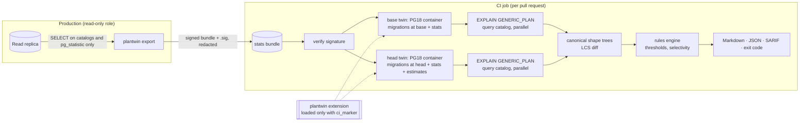

# Architecture

PlanTwin has three parts. The **export** runs on a read replica and writes a signed stats bundle. The **twin** is a
PostgreSQL 18 container with an empty schema and the imported statistics. The **check** builds a base twin and a head
twin, explains a query catalog on both, and compares the plans.

## Components and code

| Component | Responsibility | Code |
|---|---|---|
| C extension | chained `get_relation_info_hook`; overrides table and index sizes, and B-tree height, from `pg_class`; refuses to load without a CI marker | `ext/plantwin/plantwin.c`, regression tests in `ext/plantwin/sql` |
| Export | reads `pg_settings` (allow-list), `pg_class`, `pg_attribute`, `pg_statistic`; applies redaction; writes JSON | `internal/export`, `internal/bundle` |
| Bundle | format (`schema_version`), redaction modes, ed25519 signing | `internal/bundle` |
| Twin | starts PG18 containers through the docker CLI; applies migrations; imports stats; estimates new indexes; labels changed tables; schema cache | `internal/twin` |
| Estimator | sizes indexes that have no imported stats | `internal/twin/estimate_new_indexes.sql` (also used by the benchmark) |
| Plan | parses EXPLAIN JSON (three forms) | `internal/plan` |
| Shape and diff | canonical shape trees with signatures; LCS alignment | `internal/shape`, `internal/diff` |
| Rules | findings with thresholds, severities, why and fix | `internal/rules` |
| Report | Markdown with side-by-side plans, JSON (`schema_version`), SARIF 2.1.0 | `internal/report` |
| Check | orchestration: worktrees, twins in parallel, import, labels, EXPLAIN, rules, accept list | `internal/check` |
| CLI | commands, exit codes, plain-language errors | `cmd/plantwin` |
| Doctor, init, demo | readiness checks; migration-tool detection; embedded example | `internal/doctor`, `internal/initcmd`, `internal/demo` |

## Data flow for one check

1. Verify the bundle signature with `bundle.public_key`. Stop on mismatch (fail closed).
2. Create git worktrees for `--base` and `--head`. Each provides its migrations.
3. Start both twins in parallel. If the migrations are cached (keyed by a hash of the migration files), replay the
   cached schema. Otherwise apply the migrations and cache the schema.
4. Import relation and attribute statistics into each twin. Failures are recorded, not fatal, because objects the
   migration changed are expected to fail.
5. Run the estimator on each twin. Compare table signatures to label the changed tables as *estimated*.
6. For each query, start a session per worker, load the extension with the run's CI marker, apply the bundle's
   planner settings, and run `EXPLAIN (FORMAT JSON[, GENERIC_PLAN])`.
7. Canonicalise both plans, diff them, apply the rules, and drop findings accepted in `.plantwin/accepted.json`.
8. Render the report, save the last run for `plantwin explain`, and remove the twins unless `--keep` is given.

## Design decisions (ADRs)

| ADR | Decision |
|---|---|
| [0001](decisions/0001-ci-only-guard.md) | the extension refuses to load without a CI marker |
| [0002](decisions/0002-btree-height-estimate.md) | B-tree height is estimated from sizes and key widths |
| [0003](decisions/0003-hook-scope-and-loading.md) | the hook's scope; per-session loading |
| [0004](decisions/0004-extended-statistics.md) | extended statistics are detected and reported, not restored |
| [0005](decisions/0005-benchmark-sources-and-config.md) | benchmark data sources and autovacuum |
| [0006](decisions/0006-go-toolchain-in-docker.md) | Go runs in pinned containers |
| [0007](decisions/0007-canonical-shapes-and-diff.md) | canonical shapes and the LCS differ |
| [0008](decisions/0008-rules-and-selectivity.md) | rules and the selectivity cut |
| [0009](decisions/0009-dependencies-and-docker-cli.md) | two dependencies; Docker through the CLI |
| [0010](decisions/0010-estimate-new-indexes.md) | estimating indexes the PR creates |
| [0011](decisions/0011-bundle-format-redaction-and-signing.md) | bundle format, redaction and signing |
| [0012](decisions/0012-schema-cache.md) | the cache stores the schema, not the container |

## What is not in the architecture on purpose

- No database for PlanTwin's own state. Results are files in the repository (`.plantwin/`).
- No network service. The CLI talks to Docker, git and the replica only.
- No production writes. The export runs SELECTs; the twin is a disposable container.
